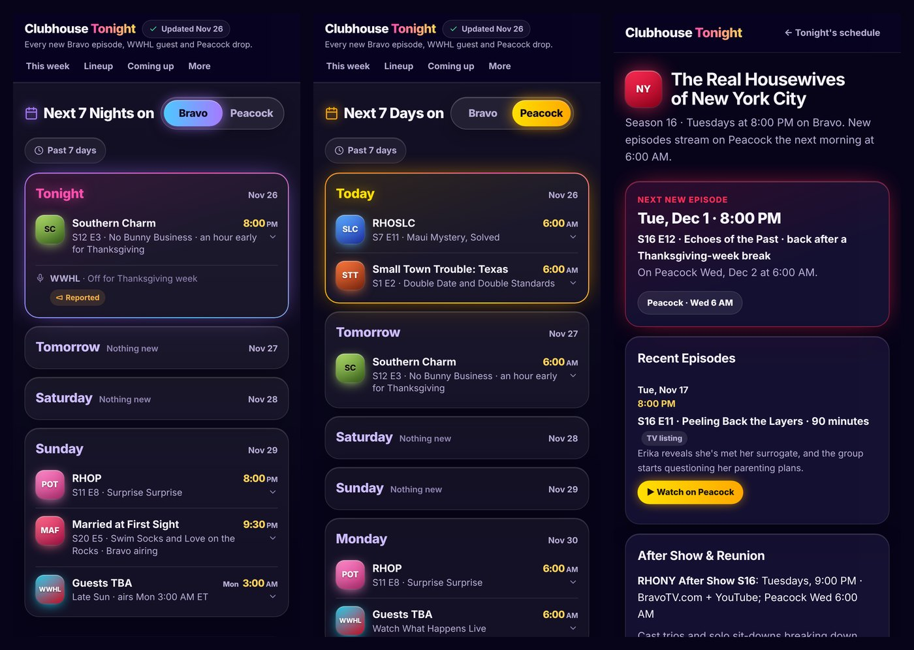
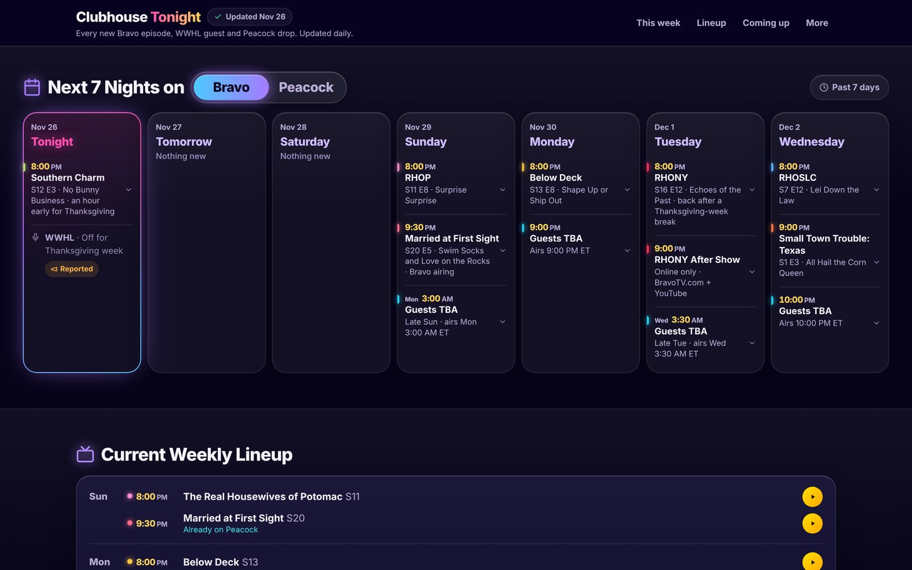

# Clubhouse Tonight

**What's new on Bravo tonight, this week, and when it hits Peacock.**
A free, fan-made TV guide for Bravo fans, live at **[clubhousetonight.com](https://clubhousetonight.com)** and refreshed every morning.



## What it does

- **Next 7 nights** of new Bravo episodes with air times, titles and short synopses. Flip to the **Peacock view** to see the same week as streaming drops (6:00 AM ET the next morning).
- **Watch What Happens Live**: every night Bravo actually lists, at Bravo's real airtime (it moves nightly, sometimes past midnight), plus guests once they're announced.
- **Premieres** with live countdowns, the weekly lineup, After Shows, reunions, events, an "On the Radar" list of announced-but-undated seasons, and premiere history.
- **A page for every show** (`/rhony`, `/wwhl`, ...), each lit in that show's colours, built for "when is the next episode of ..." searches.
- **An iPhone home-screen widget** ([/widget](https://clubhousetonight.com/widget), via Scriptable) fed by a public [`schedule.json`](https://clubhousetonight.com/schedule.json).
- **Every date is sourced.** Bravo's own schedule comes first; anything else is tagged as a TV listing, a press report, or "sources disagree".

## Design



A neon night-time TV guide: frosted "liquid glass" cards over a dark colour wash.

- **Each show glows in its own colours**, sampled from its current Bravo key art and logo: RHONY crimson, RHOSLC ice blue, RHOP blossom pink, Below Deck gold, Southern Charm green.
- **Each view wears its network.** The Bravo view uses Bravo's cyan-to-violet logo gradient, and the Peacock view uses Peacock's gold.
- **Phone first.** It's tuned for the 440 px-wide iPhone Pro Max: a solid strip behind the Dynamic Island, safe-area padding, 44 px tap targets, a top bar that tucks away while you scroll, and rounded SF numerals for times.

### Built to shine on new browsers and work everywhere

The base layer is plain flexbox, grid and hex colours with system fonts (no web fonts, nothing to download), so it renders well on any browser from the last several years. Newer browsers get extra polish, each piece behind `@supports` or simply ignored where unsupported:

| Enhancement | What you see |
|---|---|
| `oklch()` relative colours + `@media (color-gamut: p3)` | Show colours pushed past sRGB on Display-P3 screens |
| `@property` + conic gradient + `mask-composite` | A slowly turning neon ring around "Tonight" |
| `animation-timeline: view()` / `scroll()` | Cards rise in as you scroll; a progress line runs under the top bar (no JavaScript) |
| `:has()` | The Bravo/Peacock switch's glowing thumb slides between options |
| View Transitions (same-page and cross-document) | Switching views and opening a show page cross-fade |
| `interpolate-size` + `::details-content` | "More" drawers open smoothly |
| `grid-template-rows: 0fr → 1fr` | Episode details expand smoothly |
| `@starting-style`, `text-wrap: balance / pretty` | Softer first paint, tidier headlines |

Everything respects `prefers-reduced-motion`.

## How it works

```
data.js ──┐
          ├─ build.py ─► check.js (freshness + data checks; the build stops on any error)
template ─┘            ├─► index.html (+ headless-Chrome pre-render for SEO and no-JS readers)
                       ├─► showpages.py ─► /rhony, /wwhl ... · sitemap.xml · schedule.json
                       └─► widget.html
```

- **One data file.** `data.js` holds every episode, airing, premiere and source. A scheduled job researches Bravo's schedule each morning, edits only `data.js`, runs the build, and pushes. Netlify deploys `main` automatically.
- **Guard rails.** `check.js` fails the build if listings don't cover the next 7 nights, a date is malformed or in the future, a WWHL airtime is impossible, a radar item hasn't been re-verified in a week, or a show is missing its full name. The pre-render runs on a candidate file and only replaces the live page if every section rendered.
- **No framework, no bundler.** A single HTML page with inline CSS and about 25 KB of vanilla JavaScript (gzipped page about 30 KB), plus Python for the build.
- **Privacy.** No cookies, no ads, no cookie banner. Analytics are cookie-free (Cloudflare Web Analytics + Umami), live site only, and `/me` opts the owner out.

### Run it locally

```bash
python3 build.py          # needs node; Chrome optional (for the pre-render)
python3 -m http.server    # then open http://localhost:8000
```

## Credits

Designed and built by **Brent Unkrich** ([@bunkrich](https://github.com/bunkrich)) · vibe coded with Claude.
Not affiliated with Bravo, NBCUniversal or Peacock. Show names and trademarks belong to their owners; episode details are summarized in our own words with links to official sources.
