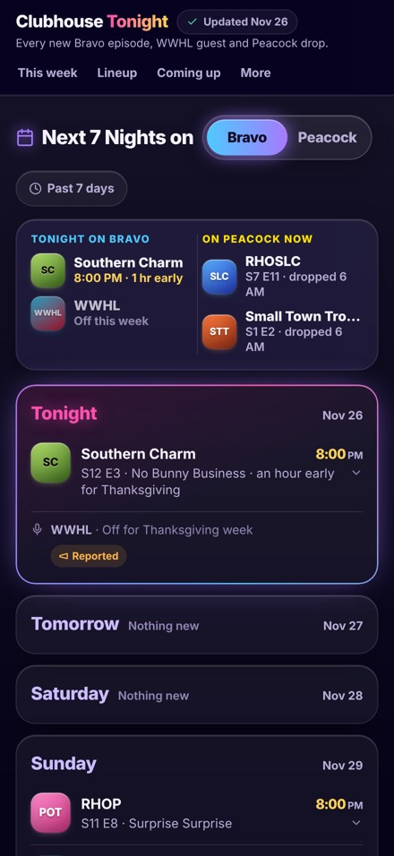

# Archived idea: "Tonight on Bravo / On Peacock now" card

Mocked up Nov 26, 2026. **Not built.** Decision: skip for now. The Bravo half repeats the Tonight card right below it, and the Peacock view already lists today's drops. Revisit if analytics show most visits use the Peacock view.



**Idea:** a split glass card above "Next 7 Nights": tonight's Bravo airings on the left, today's Peacock drops on the right, so the first screen answers both questions at a glance.

**To build it for real:** generate both columns from `EPISODES`/`WWHL` in `template.html` (tonight = `byDate(today)` + `wwFor(today)`; Peacock = rows whose `dropOf(e) === today`), reuse `badge()`, and hide it in the Peacock view.

## Static mockup markup (hard-coded Nov 26 data)

```html
<style>
.hero{margin:0 0 16px;padding:16px;display:grid;grid-template-columns:1fr 1fr;gap:12px;position:relative}
.hero .col{display:flex;flex-direction:column;gap:10px;min-width:0}
.hero .kk{font:800 11.5px/1 var(--font);letter-spacing:.09em;text-transform:uppercase}
.hero .bv .kk{color:var(--bravo1)}.hero .pc .kk{color:var(--pea1)}
.hero .it{display:flex;gap:10px;align-items:center;min-width:0}
.hero .it .badge{--bd:38px;width:38px;height:38px;border-radius:11px;font-size:11px}
.hero .t1{font-weight:760;font-size:15px;line-height:1.2;white-space:nowrap;overflow:hidden;text-overflow:ellipsis}
.hero .t2{font:700 13px/1.3 var(--num);color:var(--sun)}
.hero .pc .t2{color:var(--mut);font-family:var(--font);font-weight:600}
.hero .sep{position:absolute;left:50%;top:16px;bottom:16px;width:1px;background:var(--line)}
.hero .go{grid-column:1/-1;display:flex;justify-content:center;gap:8px;margin-top:2px}
</style>
<div class="hero glass"><span class="sep"></span>
<div class="col bv"><span class="kk">Tonight on Bravo</span>
 <div class="it"><span class="badge ink" style="--c1:#b4e06c;--c2:#3d6b1d">SC</span><div style="min-width:0"><div class="t1">Southern Charm</div><div class="t2">8:00 PM · 1 hr early</div></div></div>
 <div class="it" style="opacity:.75"><span class="badge" style="--c1:#22d3f0;--c2:#e8112d;font-size:9px">WWHL</span><div style="min-width:0"><div class="t1">WWHL</div><div class="t2" style="color:var(--mut)">Off this week</div></div></div>
</div>
<div class="col pc"><span class="kk">On Peacock now</span>
 <div class="it"><span class="badge" style="--c1:#5ab0ff;--c2:#2337b8">SLC</span><div style="min-width:0"><div class="t1">RHOSLC</div><div class="t2">S7 E11 · dropped 6 AM</div></div></div>
 <div class="it"><span class="badge" style="--c1:#ff7a3d;--c2:#8c2a12">STT</span><div style="min-width:0"><div class="t1">Small Town Trouble</div><div class="t2">S1 E2 · dropped 6 AM</div></div></div>
</div></div>
```
